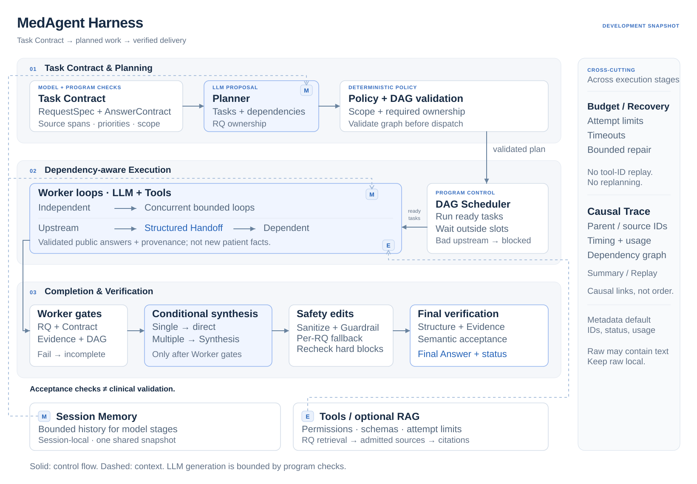

# MedAgent Harness

An execution framework for complex clinical questions: **make requirements explicit, coordinate dependent work, and verify what was delivered.**

A compound request can hide several outputs; one task may need another's result; a fluent answer may still omit a requirement. MedAgent addresses these execution problems with a Harness that controls scope, scheduling, tools and acceptance around model calls.

[Static Demo](https://young-svg.github.io/medagent-harness/) · [Architecture](docs/ARCHITECTURE.md) · [Experiment results](docs/W7_REAL_MODEL_RESULTS.md)

> **Development design review:** this branch contains documentation only, over release `6147196`. The design and experiments describe local development snapshot `499d2fa`; that implementation is not included here. See [version and source mapping](docs/ARCHITECTURE.md#version-and-source-mapping).

## Architecture



[Open the editable SVG](docs/assets/medagent-architecture.svg). The model proposes work and generates answers; the program owns permissions, scheduling, budgets and completion.

## Three core designs

### Task Contract — preserve intent through execution

The request becomes source-aligned requirements with stable IDs, MUST/OPTIONAL priorities and restrictions. A corresponding AnswerContract defines deliverables. Those IDs follow the work from planning to the final answer.

Compared with keeping requirements only in a long prompt, this creates explicit ownership and checkable completion conditions. Model-assisted extraction and a separate review are constrained by program checks for schema, source spans and scope. [Mechanism and source map](docs/ARCHITECTURE.md#core-design-decisions).

### Dependency-aware orchestration — coordinate only where needed

The Planner proposes a graph; deterministic Policy checks ownership and DAG validity. Ready tasks run concurrently. Dependent tasks wait for validated, structured Handoff, while failed upstream work blocks their model calls.

Compared with a fixed sequential chain, this exposes independent work; compared with unconstrained Agent-to-Agent chat, it keeps dependencies and transferred results inspectable. A focused request can still use one Worker. [Scheduling and Handoff](docs/RUNTIME_ARCHITECTURE.md#planning-scheduling-and-handoff).

### Reliable Execution Harness — separate generation from acceptance

Workers use bounded model/tool loops. Role and task permissions, schemas and budgets are checked before tool execution. External evidence is authorized per requirement, then tracked through admission, delivery and citation.

Compared with accepting non-empty text or a model's own completion claim, shared final acceptance checks structural coverage, evidence lineage, safety blocks and per-item semantic response. Synthesis is conditional, and both direct and synthesized answers use the same gates. [Completion path](docs/RUNTIME_ARCHITECTURE.md#completion-and-safety).

## Reliability mechanisms

| Failure mode | Harness response |
| --- | --- |
| Upstream fails or times out | Block dependent calls; preserve unrelated work and causal links |
| Runaway model/tool loop | Enforce attempt ceilings; bound transport retry, length recovery and protocol repair |
| Repeated tool-call ID | Reject before re-executing the Handler within that subtask |
| Unsupported or misassigned citation | Require authorized per-item source lineage |
| Partial, off-topic or unsafe final answer | Preserve hard blocks and distinguish incomplete, uncertain and execution-error outcomes |

Session Memory, optional RAG and fixed role instructions support this lifecycle. Causal Trace connects model, tool, Handoff and acceptance events; default development metadata retains diagnostics without recording arbitrary prompt bodies.

## Experiments: measure the orchestration trade-off

A frozen synthetic dataset and common acceptance/budget rules compare **A: single ReAct loop**, **B: single-role Plan-and-Execute**, and **C: native Planner-DAG**. The real Pilot used three cases, once per architecture, with the same frozen requirements and model configuration.

| Case | Model requests A / B / C | Provider input + output tokens A / B / C | End-to-end seconds A / B / C |
| --- | ---: | ---: | ---: |
| Simple S02 | 2 / 3 / 3 | 2,540 / 3,712 / 3,583 | 10.128 / 16.819 / 15.057 |
| Independent I03 | 2 / 4 / 5 | 3,696 / 7,701 / 8,810 | 18.835 / 37.207 / 26.762 |
| Dependent D03 | 2 / 5 / 6 | 6,444 / 12,186 / 16,750 | 32.798 / 51.275 / 54.283 |

**Observed:** A used fewer requests, tokens and elapsed time in these three cases. Same-plan C/C-serial follow-ups showed shorter concurrent Worker request spans: **9.150 vs 15.122 seconds** on I03 and **31.480 vs 51.096** on D03. D03 also recorded two upstream Handoffs before its dependent task. Memory On/Off changed whether the same follow-up request could use prior facts.

**Design takeaway:** use a single loop when coordination adds little; use DAG/Handoff when explicit dependency ownership and auditability justify orchestration cost. Concurrent Worker spans improved in the two observations, but I03's C did not improve actual end-to-end time including planning.

These are single-run execution observations, not quality rankings. Formal independent quality remains **UNSCORED**; model-assisted acceptance is not human PASS. No general Multi-Agent superiority or clinical effectiveness is claimed. [Full metrics, scoring status and experimental conditions](docs/W7_REAL_MODEL_RESULTS.md).

## Demo and quick start

The [GitHub Pages Demo](https://young-svg.github.io/medagent-harness/) shows Single, Multi/Handoff, RAG and Memory using precomputed SYNTHETIC fixtures. No API keys, model calls or backend are required.

```bash
cd web
npm ci
npm run dev
# Production static build:
npm run build
```

For the public Python release, use Python 3.11+:

```bash
python -m venv .venv
# Activate the environment, then:
pip install -e ".[dev]"
medagent --help
```

[Release-matched setup and CLI/API instructions](https://github.com/young-svg/medagent-harness/blob/61471969e187b665e37ee7227bf987c93e6a7bf6/README.md) · [Offline scheduling example](docs/RUNTIME_ARCHITECTURE.md#reproduce-a-dependent-run-without-a-provider)

## Further reading and scope

- [Architecture decisions and source mapping](docs/ARCHITECTURE.md)
- [Runtime, Handoff and final acceptance](docs/RUNTIME_ARCHITECTURE.md)
- [Real-model results and offline evidence](docs/W7_REAL_MODEL_RESULTS.md)
- [Static Demo guide](docs/STATIC_DEMO.md)

This is an engineering portfolio, not a medical device or a validated clinical service. Development security targets a trusted local operator. Synthetic sources are not real guidelines or papers; raw experiments, Trace and credentials are not part of this documentation submission.

Public viewing and evaluation do **not** grant an open-source license. Third-party licenses and outstanding publication-authority decisions remain applicable; see the [public-release audit](docs/PUBLIC_RELEASE_AUDIT.md).
