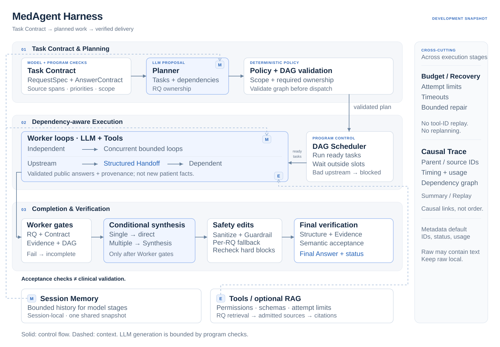

# Architecture

> **Release version:** the implementation described here is included in this checkout. It is imported from validated `499d2fa`, with reviewed `2884f86` documentation; see the historical [release review](FINAL_RELEASE_REVIEW.md).

## Core design decisions

| Design | Requirement and alternative | Mechanism / development source |
| --- | --- | --- |
| Task Contract | Preserve several outputs and restrictions; prompt-only scope is difficult to audit | Stable RQ IDs and Contract priorities follow the result. `context/request_spec.py`, `context/contract.py`; development `runtime/semantic_validation.py::SemanticValidator.extract` checks source-aligned inventories in separate contexts. |
| Dependency-aware orchestration | Some work is independent, some needs upstream results; a sequential chain wastes independence and free-form Agent chat hides prerequisites | `planning/planner.py::apply_contract_policy`, `planning/models.py::Plan.validate`, `runtime/native_engine.py::_analyze` own the executable graph; `runtime/handoff.py::build_handoff` transfers validated public results. |
| Reliable Execution Harness | Non-empty text and model self-approval cannot establish delivery | `runtime/agent_loop.py::AgentLoop.execute` and `tools/registry.py::ToolRegistry.execute` constrain execution. Development `runtime/acceptance.py::FinalAcceptance.evaluate` combines structural, evidence, safety and semantic gates. |

Paths above are relative to `medagent/`; their implementations were imported from validated commit `499d2fa`.
Memory, RAG and fixed role instructions support these three decisions; they are not
separate orchestration layers. Conditional Synthesis consolidates multiple usable
Worker outputs, while a single Worker proceeds directly to the same final gates.

## Version and source mapping

The release imports reviewed file snapshots rather than merging development
history. Shared source links below now refer to the corresponding integrated code.
Historical experiment commits identify the original runs; their raw artifacts are
not included. [Release review](FINAL_RELEASE_REVIEW.md) records exact file selection,
the portable pinned-baseline test fixture, excluded internal originals and owner decisions.

| Control boundary | Release implementation |
| --- | --- |
| Task Contract | [RequestSpec](../medagent/context/request_spec.py), [Contract](../medagent/context/contract.py), [source-aligned semantic extraction](../medagent/runtime/semantic_validation.py) |
| Plan and dispatch | [Planner/Policy](../medagent/planning/planner.py), [DAG models](../medagent/planning/models.py), [NativeEngine](../medagent/runtime/native_engine.py), [Handoff](../medagent/runtime/handoff.py) |
| Execution and acceptance | [AgentLoop](../medagent/runtime/agent_loop.py), [ToolRegistry](../medagent/tools/registry.py), [Evidence Gate](../medagent/runtime/coverage.py), [FinalAcceptance](../medagent/runtime/acceptance.py) |
| Context and audit | [Memory](../medagent/memory/session.py), [Trace](../medagent/observability/tracer.py), [metadata privacy](../medagent/observability/privacy.py), [local API](../api/main.py) |
| Reproducible evaluation | [Frozen inputs](../medagent/runtime/evaluation_inputs.py), [drift guard](../medagent/runtime/evaluation_guard.py), [Runner](../eval/w7/README.md), [frozen dataset](../experiments/w7/public_release/README.md) |

The [runtime example](RUNTIME_ARCHITECTURE.md#reproduce-a-dependent-run-without-a-provider)
explicitly selects structural-only testing; default analysis retains
semantic gates. The static Demo is still fixture-only.

## System Objective

MedAgent Harness is a centralized planner-worker runtime for traceable clinical decision-support workflows. Its objective is not autonomous diagnosis or a new foundation model. It turns a compound request into explicit work, runs that work through bounded agent and tool loops, verifies completion, and records the observable execution lifecycle.

## Execution Model

This is the same [full-size overview](assets/medagent-architecture.svg) used by the README. Solid arrows are execution/control; light dashed arrows are support/context, not additional execution stages. The Router labels the route; the engine owns scheduling. Handoff applies only to declared dependencies.

For a single successful worker, the harness can use the worker answer directly instead of running multi-worker synthesis. Both paths use shared FinalAcceptance. Incomplete results skip the optional model presentation transform. W7 evaluation interfaces are not additional stages in this diagram.

## 1. Request Structuring and Context Engineering

- **Problem:** A clinical prompt can contain several explicit questions, while a broad intent label can silently hide one of them.
- **Design:** W1 extracts and independently reviews source-aligned requirement spans in separate model contexts. Program checks validate schema, mapping and priorities. `RequestSpec` assigns ordered RQ IDs; `AnswerContract` derives deliverables from accepted positive scope and restrictions. An evidence ledger represents patient facts without inventing missing data.
- **Runtime behavior:** The current case and question are authoritative. The Planner receives task-level context; each worker receives its assigned request IDs, role-specific subtask, bounded session context, contract, profiles, and patient-fact ledger. Tool or retrieval evidence enters only through the worker loop.
- **Failure handling:** Default W1 fails closed on disagreement, invalid output, timeout or inadequate verification budget before planning. It does not silently fall back to regex decomposition. Separate verification contexts may use the same model; agreement does not guarantee correct scope. Unknown, duplicate, unassigned, or empty request-item answers cannot claim coverage.

This is stage-aware context construction, not one shared prompt and not a claim of complete long-context management.

## 2. Complexity Profiling, Planning, and Routing

- **Problem:** One worker is sufficient for focused dependent work, while broad cross-role requests benefit from explicit decomposition.
- **Design:** A deterministic complexity profile captures breadth, requested deliverables, cross-role needs, and explicit external-evidence requirements. The centralized Planner assigns bounded subtasks and ownership to the Diagnostic, Consultation, or Research worker. The Router reports a `single` or `multi` route from the validated plan.
- **Runtime behavior:** Every required request item must map to a subtask. Capability policy exposes retrieval-oriented tools only when the request explicitly requires external evidence. Workers do not create or claim arbitrary work.
- **Failure handling:** Malformed independent plans can fall back to a bounded subtask. Invalid declared dependency plans fail explicitly rather than losing dependencies. Contract policy normalizes ownership; the Router's diagnostic fallback is a route label, not a replacement for engine plan validation or scheduling.

## 3. Agent Harness and Multi-Agent Orchestration

- **Problem:** Independent model calls need common control over state, ownership, timeouts, tools, completion, and traceability.
- **Design:** `NativeMedAgentEngine` coordinates the lifecycle; `AgentLoop` owns each worker's model/tool loop. Worker roles have explicit scopes and safety boundaries. The harness, rather than the model, owns dispatch and completion state.
- **Runtime behavior:** Independent subtasks run concurrently. Validated `depends_on`
  edges wait for successful upstream results; execution timeouts begin after waiting.
  Sanitized, structured Handoff carries source task/Worker IDs, per-item answers and
  the source Worker event ID, separately from patient facts and Memory. Results retain
  plan order; same-role dependency tasks keep their identities. Contract reconciliation
  preserves required deliverable ownership without dropping dependencies. The Diagnostic
  worker covers assessment/workup, Consultation covers care, and Research covers evidence.
- **Failure handling:** Worker exceptions and timeouts become explicit failed-worker results.
  Invalid dependency graphs fail explicitly. Unusable upstream output blocks descendants
  without their model calls, even if unrelated work covers the same request. Handoff filters
  complete and unterminated reasoning tags before its Trace event and downstream prompt.

## 4. Tool Use and Optional RAG

- **Problem:** Unbounded or globally exposed tools make agent behavior difficult to control and audit.
- **Design:** The tool registry filters schemas by worker role and request-derived capability policy, revalidates tool names at execution, and enforces independent per-subtask attempt budgets. Retrieval is a tool-backed optional capability with `off`, deterministic `fake`, and user-configured `milvus` modes.
- **Runtime behavior:** Workers can call visible functions inside the AgentLoop. Retrieval targets a declared RQ, routes the query, admits candidates and returns compact evidence. Runtime records bind tool execution, source category, admission, delivery and citation to that RQ. Multi-RQ tasks identify the retrieval target. Handoff reuse requires an authorized relationship; receiving another RQ's source cannot complete a new retrieval requirement. Repeated tool-call IDs terminate the subtask before re-execution, including after recovery.
- **Failure handling:** Invisible, missing, malformed, or over-budget tool calls return explicit errors to the loop. `off` mode fails retrieval explicitly; incomplete Milvus configuration or missing optional packages raises a configuration error instead of silently using private local data.

The base runtime does not require RAG for every question. Explicit required sources need actual retrieval or authorized reuse; a model's claim of having consulted sources is insufficient. Evidence Gate validates execution and lineage, not relevance, entailment, freshness or directory authenticity. Users must supply and govern any real corpus themselves.

## 5. Session Memory

- **Problem:** Follow-up requests need relevant prior turns without mixing users or treating stale context as authoritative.
- **Design:** `SessionMemory` is bounded, process-local, and keyed by `session_id`. Omitted IDs generate fresh selectors; explicit reuse continues a session. Selectors are not authentication. The API supports a trusted local operator with loopback peer/Host/origin checks and an optional operator Bearer secret, not public multi-tenant deployment.
- **Runtime behavior:** One shared history snapshot is injected into Planner and all Workers.
  Count limiting precedes whole-message, oldest-first trimming to an estimated budget
  (default 4096; 0 excludes history; None disables the budget). UTF-8 JSON bytes plus
  framing are a conservative proxy, not actual tokenizer usage or a model-window hard
  limit. Current input/task context is not trimmed. CLI/API default Memory inherits
  RuntimeConfig; explicit custom Memory retains its settings. Accepted, deduplicated
  writes are counted in Trace. Memory does not persist patient records.
- **Failure handling:** Memory can be disabled, cleared per session, and never crosses session IDs. The recent-message limit prevents unbounded accumulation; process restart intentionally clears the state.

## 6. Worker Responses and Completion Gates

- **Problem:** A worker can return fluent text while omitting an assigned item or violating the structured response protocol.
- **Design:** Worker output maps answers to assigned `request_item_id` values. Shared `runtime/acceptance.py::FinalAcceptance` combines RequestSpec/Contract structural coverage, Evidence Gate, hard safety blocks and final W2 semantic acceptance.
- **Runtime behavior:** Only schema-valid, non-empty answers from successful workers count structurally. Evidence is checked before usable Handoff. Multiple successful Workers use Synthesis only after preflight coverage/dependency checks; final citations are checked again after edits. W2 receives final answers and scope, not generator reasoning or prior self-approval. Optional omissions do not block MUST completion.
- **Failure handling:** Unknown IDs, duplicate IDs, empty answers, and unassigned answers do not count. Missing required request items or deliverables returns an explicit `incomplete` result with the missing IDs instead of presenting a partial answer as complete. W2 distinguishes unanswered, off-topic, insufficient-information, uncertain and execution-error results; invalid validation fails closed. Unresolved hard safety blocks prevent completed even with semantic validation disabled. These model judgments do not certify medical correctness.

## 7. Synthesis, Guardrails, and Presentation

- **Problem:** Combining worker drafts can introduce omissions or inconsistencies, and presentation should not create a second clinical conclusion.
- **Design:** The Synthesizer receives the contract, request map, profiles, and successful worker drafts. A conservative Guardrail checks contract coverage and contradictions against the patient-fact ledger, then applies only stable whole-unit edits. Presentation derives patient, clinical, and developer views from the same final answer.
- **Runtime behavior:** Multi-worker drafts are reduced to the smallest complete response; a single-worker draft bypasses synthesis. The guardrail runs on either path. Provider-backed presentation transformation is optional.
- **Failure handling:** Provider failure or exhausted synthesis is a stage error. Malformed,
  duplicate, missing or empty per-item synthesized answers can be recovered deterministically
  from corresponding validated Worker answers, without a repair call. Final required IDs and
  substantive content are rechecked after sanitizer and stable Guardrail edits. Unrecoverable
  answers return incomplete; Worker coverage and final coverage remain separate. Final
  evidence requirements, W2 and accumulated Guardrail hard blocks still apply; a later
  successful check or fallback cannot clear an unresolved hard block. Incomplete
  runs skip the optional presentation transform. If the transform fails, deterministic
  presentation remains available without changing the final answer or coverage state.

## 8. Reliability Control

- **Problem:** Transient provider faults, truncated generations, and malformed structured output require different responses. Treating all three as a generic retry can replay work or alter semantics.
- **Design:** Recovery is stage- and failure-specific, bounded, and observable.
- **Runtime behavior:**
  1. **Infrastructure retry:** a worker retries at most twice for classified transient transport, rate-limit, or server failures, with one- and two-second backoff by default. Attempt count, delay, and error type remain visible in the trace.
  2. **Length completion recovery:** a stage can make at most one bounded continuation attempt after an unusable length-truncated response.
  3. **Worker protocol recovery:** after non-empty semantic content with `finish_reason=stop` fails parsing, one temperature-zero call receives only the malformed output, allowed request IDs, and required schema.
- **Failure handling:** Protocol recovery has no tools, no Planner rerun, no tool replay, no full case or session reinjection, and no quality-triggered retry. Repaired output must pass the strict parser and the same downstream completion gates; a failed repair terminates that worker path.

## 9. Observability and Evaluation

- **Problem:** Agent quality and reliability cannot be assessed from the final answer alone.
- **Design:** A central recorder emits JSONL events. Default metadata projection validates allowed IDs, fixed statuses, counts, usage and timing; arbitrary content is omitted. Credential redaction is an additional boundary, not clinical de-identification. Evaluation remains separate from runtime execution.
- **Runtime behavior:** Trace records context, model/tool/retrieval boundaries, coverage,
  recovery, Handoff provenance and final status. Causal parents are explicit; unrelated
  concurrent events are not connected by append order. Worker request coverage and final
  output coverage are distinct. Validated wait/source/Handoff UUIDs preserve dependency
  and evidence causality in metadata. Loaded role-spec names/hashes associate with actual
  model stages; loading four is not executing four. Metadata Replay cannot restore
  omitted answers. Explicit raw mode retains sensitive content for local Replay and
  must not be published. HTTP execution summaries are metadata even if disk mode is raw.
- **Failure handling:** Errors and recovery outcomes are events with sanitized error metadata. Local traces are excluded from the public repository and can be summarized or replayed read-only.

Evaluation evidence is documented in:

- [W7 real-model results and offline boundaries](W7_REAL_MODEL_RESULTS.md)
- [Benchmark](BENCHMARK.md)
- [Reliability](RELIABILITY.md)
- [Failure analysis](FAILURE_ANALYSIS.md)

## Capability Boundaries

Implemented capabilities include context engineering, centralized planning, multi-agent orchestration, controlled function calling, optional evidence retrieval, session-scoped memory, completion verification, bounded recovery, tracing, and offline evaluation fixtures.

The project does not claim persistent cross-session memory, autonomous learning, skill self-evolution, a complete reflection framework, complete long-context management, clinical validation, or medical-device approval.
