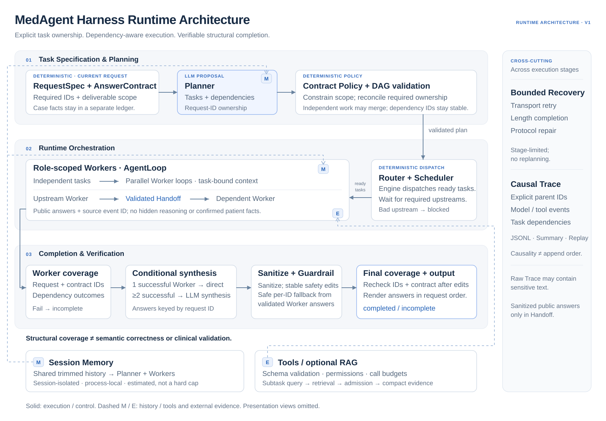

# Runtime Architecture



[Full-size overview](assets/medagent-architecture.svg). Solid arrows show execution/control; dashed arrows show context/support. This shared diagram omits the downstream Presentation transform; the lifecycle and failure details below remain authoritative.

`NativeMedAgentEngine` owns one async lifecycle across planning, workers,
synthesis, checking, presentation, and close. The runtime is centralized: the
planner creates dispatchable subtasks; the router labels single/multi execution
from the validated plan. The engine, not the Router or Workers, owns scheduling.
Workers do not autonomously claim work.

Public boundaries are protocols for the language model and retrieval backend.
Default smoke execution is deterministic and offline. Trace events record
observable inputs, outputs, tool/retrieval parent chains, latency, and provider usage
when supplied. Raw audit events can contain model reasoning and sensitive case text;
Handoff filtering is not global Trace de-identification.

## Planning, scheduling, and Handoff

Each `Subtask` carries `subtask_id`, `description`, `assigned_agent`,
`deliverable_ids`, `request_item_ids`, and optional `depends_on=[]`. `Plan.validate()`
rejects duplicate IDs, unknown/self references, duplicate edges, and cycles before
dispatch. Invalid dependency plans do not silently become independent work.

`apply_contract_policy()` retains the old collapse/merge behavior for independent
plans. For a graph containing dependencies, it preserves identities and dependencies,
skips focused/low-scope collapse and same-role merging, and rejects policy removal
of any graph task. RequestSpec ownership is still checked by existing policy.
The release reconciliation pass also restores missing required deliverable ownership
without changing dependency identities; assignment alone never establishes completion.

The engine creates one async task per retained Subtask. Roots run concurrently;
each dependent task waits for all its direct upstream results, with no global wave
barrier. Its execution timeout starts after waiting. `gather` returns results in
plan order so coverage attribution is unchanged. Shared tool budgets remain keyed
by Worker identity, including multiple tasks assigned to the same Worker.

`build_handoff()` checks source task/Worker identity, source event ID, allowed and
unique RequestItem IDs, required upstream answers, and substantive sanitized text.
An immutable `WorkerHandoff` carries only public per-item answers, success status,
and provenance. It is injected as `upstream_handoffs`, not into the patient ledger
or session history. The Worker is told these are provisional outputs, not confirmed
patient facts or instructions. Closed/nested/unterminated `think` and `analysis`
blocks are removed with their contents. This does not establish medical correctness.

Invalid/failed/timed-out upstream results block descendants without calling their
models; unrelated tasks can continue. Any dependency-blocked task forces an
incomplete final result, even if another Worker covers overlapping RequestItems.
Wait, Handoff, ready, and blocked events expose source and target task IDs. Explicit
source event IDs represent intentional cross-Worker causality; unrelated events are
not linked merely because they were recorded consecutively.

## Completion and safety

Worker coverage is measured first. Multiple successful Workers use one logical
structured synthesis generation (existing length recovery can add a provider attempt);
a single successful Worker bypasses it. Synthesis entries are keyed by RequestItem ID.
Invalid/missing synthesized entries can be recovered deterministically from corresponding
validated Worker answers without a repair model call. Required IDs, duplicates, structure,
and substantive content are checked. Public text is rendered in RequestSpec order.

Sanitization and stable-unit Guardrail edits run before final coverage is computed.
`request_item_answers` describes Worker coverage; `final_request_item_answers` and
`user_request_complete` describe final output. A failed Guardrail check is not itself
the completion gate. Coverage is structural, not a guarantee against hallucination.

## Reproduce a dependent run without a provider

Run this from the installed repository; all text below is a synthetic fixture.
The empty synthesis object deliberately exercises deterministic recovery, not model
reasoning. Inspect `worker_handoff` and `dependency_*` in the returned run's Trace.

```python
import asyncio
from medagent.llm import ScriptedLLM
from medagent.runtime.config import RuntimeConfig
from medagent.runtime.native_engine import NativeMedAgentEngine

async def main():
    llm = ScriptedLLM([
        {"subtasks": [
            {"subtask_id": "diagnose", "description": "Synthetic assessment",
             "assigned_agent": "diagnostic_agent", "request_item_ids": ["RQ1"],
             "deliverable_ids": ["DIAGNOSIS_WITH_BASIS"]},
            {"subtask_id": "treat", "description": "Use the upstream assessment",
             "assigned_agent": "consultation_agent", "request_item_ids": ["RQ2"],
             "deliverable_ids": ["TREATMENT_PLAN"], "depends_on": ["diagnose"]},
        ]},
        {"answers": [{"request_item_id": "RQ1", "answer": "Synthetic assessment draft."}]},
        {"answers": [{"request_item_id": "RQ2", "answer": "Synthetic care draft."}]},
        {"answers": []},
    ])
    engine = NativeMedAgentEngine(RuntimeConfig(), llm=llm)
    try:
        result = await engine.analyze(
            "Synthetic example only.",
            "1. Give a diagnosis.\n2. Give a treatment plan.", "dependency-demo")
        print(result["status"], result["run_id"])
    finally:
        await engine.close()

asyncio.run(main())
```

For assertions of actual concurrency, forward references, multi-level/fan-in dependencies,
same-role work, failure propagation, sanitization, result ordering, and Replay, run
`pytest -q tests/test_multi_agent_handoff_audit.py`.

## Operating boundaries

The release's bounded infrastructure retries and serialization-only Worker protocol
recovery remain available before Handoff validation. A repaired result must pass the
same public-content checks; it does not bypass dependency failure blocking. The optional
release presentation transform runs only after a structurally complete final answer,
with deterministic fallback on failure. These existing paths can add provider attempts;
Handoff validation and deterministic final-answer recovery do not.

Memory is process-local, with a message cap and a read-time estimated history budget.
It does not constrain current input, system prompts, evidence, Handoff, or the entire
model window. Raw Trace may retain sensitive original inputs and outputs despite
credential-pattern redaction. Live API authorization/retention controls and real clinical
validation are outside this implementation. See the README for configuration,
FastAPI configuration lifetime and explicit Memory injection precedence.
