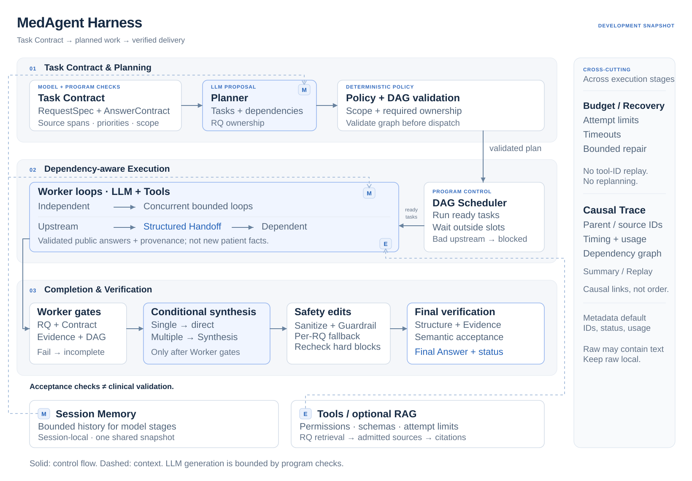

# Runtime Architecture

> **Development snapshot `499d2fa`.** This docs-only branch retains release `6147196` code. Development additions below are not shipped here; shared source links open the older release. See [version mapping](ARCHITECTURE.md#version-and-source-mapping).



[Full-size overview](assets/medagent-architecture.svg). Solid arrows show execution/control; dashed arrows show context/support. This shared diagram omits the downstream Presentation transform; the lifecycle and failure details below remain authoritative.

`NativeMedAgentEngine` owns one async lifecycle across planning, workers,
synthesis, checking, presentation, and close. The runtime is centralized: the
planner creates dispatchable subtasks; the router labels single/multi execution
from the validated plan. The engine, not the Router or Workers, owns scheduling.
Workers do not autonomously claim work.

Public boundaries are protocols for the language model and retrieval backend.
Default smoke execution is deterministic and offline. Trace events record
tool/retrieval parent chains, latency and Provider usage when supplied. Disk defaults
to metadata: safe diagnostics survive, original inputs/outputs do not. Explicit raw
mode can retain sensitive text; Handoff filtering is not global de-identification.
Metadata Replay retains status/timeline, not omitted answer bodies. HTTP execution
summaries are metadata regardless of disk mode.

Default analyze uses W1 extraction and an independent source-span review, with
program validation and Contract derivation. Uncertain or invalid output fails closed
before Planner. W1/W2 add at most three verification calls. Trusted Python
analyze_frozen takes immutable human specifications, retains W2 and all hard gates,
and can export/replay a validated plan. It is an execution-layer experiment seam,
not an HTTP feature. See [W7 results](W7_REAL_MODEL_RESULTS.md).

## Planning, scheduling, and Handoff

Each `Subtask` carries `subtask_id`, `description`, `assigned_agent`,
`deliverable_ids`, `request_item_ids`, and optional `depends_on=[]`. `Plan.validate()`
rejects duplicate IDs, unknown/self references, duplicate edges, and cycles before
dispatch. Invalid dependency plans do not silently become independent work.

`apply_contract_policy()` retains the old collapse/merge behavior for independent
plans. For a graph containing dependencies, it preserves identities and dependencies,
skips focused/low-scope collapse and same-role merging, and rejects policy removal
of any graph task. RequestSpec ownership is still checked by existing policy.
The development reconciliation pass also restores missing required deliverable ownership
without changing dependency identities; assignment alone never establishes completion.

The engine rejects plans exceeding `max_subtasks` (default 16), both before policy
normalization and before dispatch, without truncating the graph. It creates one async
task per retained Subtask. Ready Workers share at most `max_concurrent_workers` execution
slots (default 4); dependency waits do not occupy slots. The Worker timeout starts after
dependencies and slot acquisition. `gather` returns results in plan order.
Tool attempts are bounded per Subtask (default 2), including same-role independent
tasks; `calls_for(worker)` remains an aggregate diagnostic. Each Worker has at most
8 actual model calls by default, including infrastructure retries, length recovery
and protocol repair. See W4 budget scope and limitations (`W4_RUNTIME_BUDGETS.md`; unpublished development file).

`build_handoff()` checks source task/Worker identity, source event ID, allowed and
unique RequestItem IDs, required upstream answers, and substantive sanitized text.
An immutable `WorkerHandoff` carries only public per-item answers, success status,
and provenance. It is injected as `upstream_handoffs`, not into the patient ledger
or session history. The Worker is told these are provisional outputs, not confirmed
patient facts or instructions. Closed/nested/unterminated `think` and `analysis`
blocks are removed with their contents. This does not establish medical correctness.

Invalid/failed/timed-out upstream results block descendants without calling their
models; unrelated tasks can continue. Any dependency-blocked task forces an
incomplete final result, even if another Worker covers overlapping RequestItems.
Wait, Handoff, ready, and blocked events expose source and target task IDs. Explicit
source event IDs represent intentional cross-Worker causality; unrelated events are
not linked merely because they were recorded consecutively.

## Completion and safety

Worker coverage is measured first. Multiple successful Workers use one logical
structured synthesis generation (existing length recovery can add a provider attempt);
a single successful Worker bypasses it. Synthesis entries are keyed by RequestItem ID.
Invalid/missing synthesized entries can be recovered deterministically from corresponding
validated Worker answers without a repair model call. Required IDs, duplicates, structure,
and substantive content are checked. Public text is rendered in RequestSpec order.

Sanitization and stable-unit Guardrail edits run before final coverage is computed.
`request_item_answers` describes Worker coverage; `final_request_item_answers` and
`user_request_complete` describe final output. A Guardrail keyword result is not the
sole completion gate. Shared `FinalAcceptance.evaluate` performs Worker preflight,
conditional Synthesis, safety edits, final structural/evidence checks and W2 acceptance.
Unresolved blocking_issues prevent completed even with semantic validation disabled;
later edits/fallback do not clear earlier hard blocks. Required evidence needs valid
retrieval/admission/delivery/citation lineage or authorized reuse. W2 fails closed on
unanswered, off-topic, insufficient, uncertain or invalid results. Optional omissions
do not block required completion. Neither structure nor model-assisted acceptance
guarantees medical correctness.

## Reproduce a dependent run without a provider

This is a deterministic scheduling example, not a reasoning or acceptance-quality
test. It is runnable on the public release checkout and explicitly adapts to the
development configuration:

| Version | Request / acceptance configuration | Scripted model calls |
| --- | --- | --- |
| Public release `6147196` | No semantic-validation field or model-assisted requirement/acceptance stages | Planner + two Workers + Synthesis |
| Development `499d2fa` | `semantic_validation_enabled=False` explicitly selects structural-only mode | Same four calls; no extraction, independent review or semantic acceptance |

The example supplies the graph and answers. The empty Synthesis response exercises
deterministic per-RQ fallback, not another model repair. Program safety/evidence checks
still apply where implemented. Success here is not evidence that the semantic gates ran.

```python
import asyncio
from pathlib import Path
from tempfile import gettempdir
from uuid import uuid4

from medagent.llm import ScriptedLLM
from medagent.observability.replay import read_trace
from medagent.runtime.config import RuntimeConfig
from medagent.runtime.native_engine import NativeMedAgentEngine

async def main():
    llm = ScriptedLLM([
        {"subtasks": [
            {"subtask_id": "diagnose", "description": "Synthetic assessment",
             "assigned_agent": "diagnostic_agent", "request_item_ids": ["RQ1"],
             "deliverable_ids": ["DIAGNOSIS_WITH_BASIS"]},
            {"subtask_id": "treat", "description": "Use the upstream assessment",
             "assigned_agent": "consultation_agent", "request_item_ids": ["RQ2"],
             "deliverable_ids": ["TREATMENT_PLAN"], "depends_on": ["diagnose"]},
        ]},
        {"answers": [{"request_item_id": "RQ1", "answer": "Synthetic assessment draft."}]},
        {"answers": [{"request_item_id": "RQ2", "answer": "Synthetic care draft."}]},
        {"answers": []},
    ])
    trace_dir = Path(gettempdir()) / ("medagent-doc-example-" + uuid4().hex)
    settings = {"trace_dir": str(trace_dir), "retrieval_mode": "off"}
    # The public release has no W1/W2 setting; never pass it an unknown field.
    if "semantic_validation_enabled" in RuntimeConfig.__dataclass_fields__:
        settings["semantic_validation_enabled"] = False
    engine = NativeMedAgentEngine(RuntimeConfig(**settings), llm=llm)
    try:
        result = await engine.analyze(
            "Synthetic example only.",
            "1. Give a diagnosis.\n2. Give a treatment plan.", "dependency-demo")
        events = read_trace(trace_dir / result["run_id"])
        handoffs = [e for e in events if e["event_type"] == "worker_handoff"]
        assert len(llm.requests) == 4
        assert len(handoffs) == 1
        print(result["status"], "calls:", len(llm.requests), "handoffs:", len(handoffs))
    finally:
        await engine.close()

asyncio.run(main())
```

The script uses an injected ScriptedLLM and new temporary local Trace directory,
not an endpoint or clinical service. The branch's four-call path can be checked from
`llm.requests`; dependency events and the Handoff's source UUID are independently
inspectable in the saved Trace. This does not test actual concurrency with one
dependent chain. Broader offline dependency assertions are in
[the Handoff tests](../tests/test_multi_agent_handoff_audit.py).

Documentation check on this release-based branch: `completed`, 4 scripted calls,
1 Handoff, zero Provider requests. The development-only configuration branch was
checked against stored `499d2fa` source; it is not a run of default semantic validation.


## Operating boundaries

The runtime's bounded infrastructure retries and serialization-only Worker protocol
recovery remain available before Handoff validation. A repaired result must pass the
same public-content checks; it does not bypass dependency failure blocking. The optional
optional presentation transform runs only after an accepted completed final answer,
with deterministic fallback on failure. These existing paths can add provider attempts;
Handoff validation and deterministic final-answer recovery do not.

Memory is process-local, with a message cap and a read-time estimated history budget.
It does not constrain current input, system prompts, evidence, Handoff, or the entire
model window. Omitted Sessions get fresh selectors; explicit reuse continues history.
Session IDs are not credentials. API access is restricted to a trusted local operator
by transport-level loopback, Host/origin checks and an optional Bearer secret. Run
lookup checks the registered Session/operator relationship. This is not public
multi-user authorization. Raw Trace retention, full deployment hardening and clinical
validation remain outside this scope. See W3 boundaries (`W3_SESSION_SECURITY.md`; unpublished development file) and
the README for configuration and explicit Memory injection precedence.
